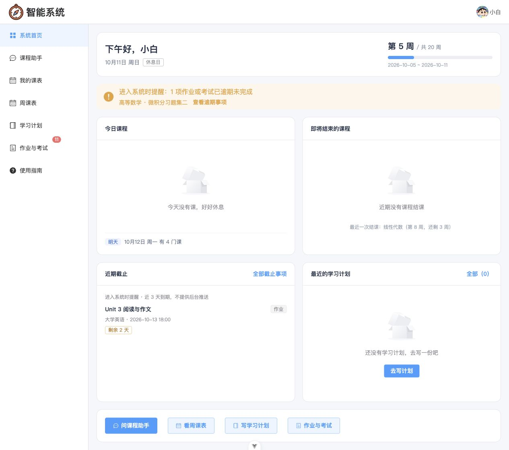
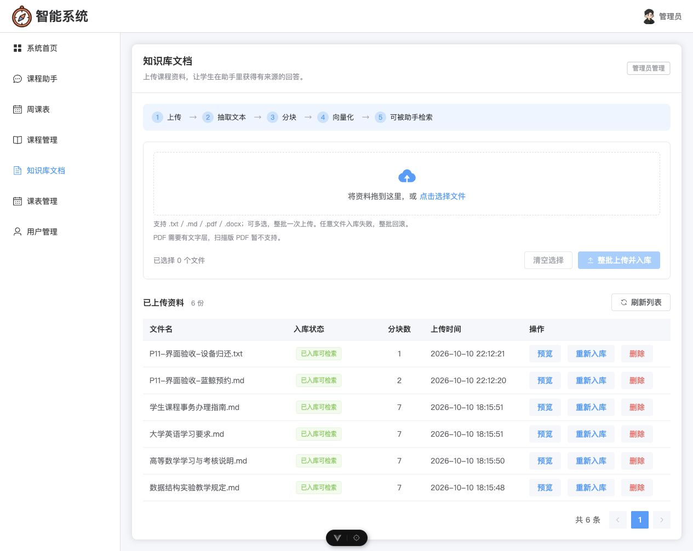

# 校园课程智能助手

一个面向高校学生的**课程智能助手**：用自然语言查课表、问课程资料、生成学习计划。基于 Vue 3 + FastAPI + MCP + LangChain Agent + RAG 实现。

课表来自 MySQL 中当前用户的排课记录，资料问答依据管理员入库的课程文档并标注来源文件。系统分别处理检索失败、无命中与片段不含答案的情况，帮助用户判断回答依据。

在线演示：[校园课程智能助手](https://43.129.170.247)。使用独立虚构数据，演示账号由项目维护者提供。

独立公网演示的容器部署包、虚构数据初始化和真实 AI 限额见 [公网演示部署手册](deploy/demo/README.md)。可使用域名或公网 IP 的可信 HTTPS，配置独立服务器与演示 Key；仓库地址是源码入口。

## 界面预览

以下截图来自 2026-10-10 至 2026-10-11 的本地演示验收，使用演示账号和演示数据；源码仓库不包含对应数据库或私有知识库。

**学生首页与截止提醒**



**管理员查看学生周课表**


**知识库批量上传与文档管理**



---

## 目录

- [它解决什么问题](#它解决什么问题)
- [技术栈](#技术栈)
- [快速开始](#快速开始)
- [功能清单](#功能清单)
- [系统架构](#系统架构)
- [几个值得说的设计决策](#几个值得说的设计决策)
- [目录结构](#目录结构)
- [测试与验证](#测试与验证)
- [文档索引](#文档索引)
- [已知限制](#已知限制)

---

## 它解决什么问题

学生的课程信息散落在教务系统、课程群、老师口头通知里。这个系统把三件事收在一处：

| 需求 | 系统怎么做 |
| --- | --- |
| "我明天有什么课？" | 助手调用 MCP 工具查**你自己的真实课表**，返回节次、课程、地点 |
| "实验课前需要预习吗？" | 检索管理员入库的课程资料，依据原文回答并**标注来源文件** |
| "帮我生成一份学习计划" | 结合你的课表生成计划；**只有明确说"保存"才写入数据库** |

两条贯穿全项目的原则：

1. **用户身份由系统传递，不由模型填写。** JWT 从请求头一路传到 MCP 工具，工具自己解析用户 ID；模型无法通过参数越权查询他人数据。
2. **检索不到就如实说，不许编造。** "检索失败"（服务不可用）和"没有命中"（资料里确实没有）在校验层就是**两种不同的返回结构**。

---

## 技术栈

| 层级 | 技术 | 职责 |
| --- | --- | --- |
| 前端 | Vue 3 + Element Plus + Vite | 页面、表格、周课表网格、对话窗口 |
| 前端渲染 | marked + DOMPurify | 安全渲染 Markdown 回答（先净化再 `v-html`） |
| 后端 | FastAPI + SQLAlchemy + MySQL | 业务接口 |
| 鉴权 | JWT | 标识当前用户，贯穿到工具层 |
| 工具协议 | FastMCP（**独立进程**，Streamable HTTP） | 把业务能力暴露为标准工具 |
| 智能编排 | LangChain `create_agent`（底层 LangGraph） | ReAct 循环：决定调不调工具、调哪个、调几次 |
| MCP 客户端 | `langchain-mcp-adapters` | 把 MCP 工具加载成可调用工具 |
| 流式推送 | SSE | 把处理状态、工具调用、回答文字推给前端 |
| 知识库 | Chroma + Embedding（bge-m3） | 文档向量化与检索 |

模型走 **OpenAI 兼容接口**，默认对接 DeepSeek（`deepseek-chat`）；Embedding 默认对接硅基流动（`BAAI/bge-m3`）。

**运行时需要三个进程**：

| 进程 | 地址 | 职责 |
| --- | --- | --- |
| 前端 | `http://127.0.0.1:5173` | 页面与对话 UI |
| FastAPI | `http://127.0.0.1:8000` | 业务接口 + 对话入口 |
| FastMCP | `http://127.0.0.1:8001/mcp` | 执行查课表 / 检索资料 / 存计划 |

> MCP 服务没启动时，助手无法调用任何工具——会明确提示"MCP 服务不可用"，而不是假装回答。

---

## 快速开始

### 前置要求

- Python 3.12+、Node.js 22+、MySQL 8.0+
- 两个 API Key：DeepSeek（对话）、硅基流动（Embedding）

### 从 GitHub 获取与首次配置

```bash
git clone https://github.com/jzp-221/campus-course-agent.git
cd campus-course-agent
python3 -m venv backend/.venv
backend/.venv/bin/python -m pip install -r backend/requirements.txt
cp backend/.env.example backend/.env
(cd frontend && npm ci)
```

自行创建一个**新的本地演示数据库**，将数据库连接、JWT 密钥和两个 API Key 填入 `backend/.env`。`DATABASE_URL` 示例中的账号、密码和库名都需改为自己的配置。然后仅在该新库中执行安全的演示账号模板：

```bash
mysql -u YOUR_MYSQL_USER -p YOUR_DEMO_DATABASE < sql/demo_users.example.sql
```

模板只包含公开的演示账号（`admin/admin`、`aaa/123`、`bbb/123`），不含邮箱、手机号或原数据库备份；已存在的同名账号不会被覆盖。FastAPI 首次启动会通过 ORM 创建其余业务表。演示账号仅适合本地演示环境。

仓库只上传源码、测试和展示截图；`.env`、数据库、原始课程文档、向量库、上传文件、备份和真实接口导出均不上传。知识库问答需要管理员自行上传有权使用的课程资料。截图是阶段验收记录，截图中的数据不会自动导入到克隆后的数据库。

前端本地开发默认使用相对 `/api` 地址及 Vite 代理，不需要本机的 `frontend/.env.development`。GitHub 仓库用于展示和获取源码，GitHub Pages 不能运行本项目的 FastAPI、MCP 或 MySQL 服务。

### 一键启动

```bash
# 位于克隆后的 campus-course-agent 仓库根目录
./start.sh
```

脚本会依次检查并启动：MySQL 连通性 → 后端依赖与 `.env` → FastAPI（8000）→ MCP（8001）→ 前端（5173）。

| 选项 | 用途 |
| --- | --- |
| （无） | 自检后启动三个服务；已在运行的会**复用**，不会重复启动 |
| `--check` | 只做环境自检，不启动任何服务（演示前建议先跑一次） |
| `--no-frontend` | 只启动后端与 MCP（前端你自己 `npm run dev` 时用） |
| `--restart-mcp` | 先握手确认 8001 提供本项目 MCP 工具，再关闭并启动新的；无法确认时拒绝关闭 |

自检会验证：Python/Node 版本、依赖是否安装、`.env` 必需项是否存在、数据库能否连接、**两个 Key 是否能真正调通**（会实际调用一次）、端口占用情况。有失败项就拒绝启动。启动后逐一验证 FastAPI 的接口清单、MCP 的 Streamable HTTP 握手与工具清单、前端页面；三者都就绪才显示“启动完成”。任一服务退出或在默认 30 秒内未就绪，脚本以非零退出码结束并回收本次新建的服务；日志路径显示在终端，日志目录仅当前用户可访问。可用 `STARTUP_TIMEOUT_SECONDS=60 ./start.sh` 调整等待时间（1～120 秒）。

> 按 `Ctrl+C` 停止时，**只会关掉本次启动的进程**——复用的服务继续运行。显式指定 `--restart-mcp` 时，确认属于本项目的原 MCP 会先被替换。
>
> 遇到 `8001 已被占用` 导致冒烟脚本拒绝运行时，用 `./start.sh --restart-mcp` 一键重来。

### 手动启动

```bash
# 1) 先按本机的安装方式启动 MySQL，并完成上述数据库与 .env 配置

# 2) 后端：在 backend 目录
cd backend
python -m venv .venv && .venv/bin/pip install -r requirements.txt
cp .env.example .env      # 然后填入你自己的 Key
.venv/bin/python -m uvicorn app.main:app --reload --port 8000

# 3) MCP：另开一个终端，同样在 backend 目录
cd backend && .venv/bin/python mcp_server.py

# 4) 前端：再开一个终端
cd frontend && npm install && npm run dev
```

### 准备演示数据

```bash
cd backend
.venv/bin/python scripts/migrate_schedule_weeks.py        # 表结构迁移（幂等）
.venv/bin/python tests/manual/seed_demo_schedules.py      # 课程库 + 20 周随机课表
```

演示账号：

| 用户名 | 密码 | 角色 | 说明 |
| --- | --- | --- | --- |
| `admin` | `admin` | 管理员 | 课程管理、课表管理、用户管理、知识库文档 |
| `aaa` | `123` | 学生 | **课表密集**，用于演示查课表与问资料 |
| `bbb` | `123` | 学生 | **课表稀疏**（只有 5 门课），用于演示数据隔离 |

> `aaa` 与 `bbb` 的课表刻意做成**完全不同**：切换账号后你能直观看出"确实只查到了自己的数据"，而不只是"看起来像隔离"。

---

## 功能清单

### 学生端

| 功能 | 说明 |
| --- | --- |
| 课程助手 | 流式对话（SSE）、过程区显示工具调用、多轮上下文、Markdown 回答、**对话记录本地保存** |
| 周课表 | 20 周 × 4 档节次的网格，翻周切换、方向键操作、固定配色、节假日自动空出 |
| 课程时间轴 | 横向条形展示每门课的起止周与剩余周数 |
| **作业与考试** | 关联课程，记录截止/考试时间与完成状态；逾期高亮、3 天内到期提示 |
| **课程详情** | 点一门课看全：课程信息、上课安排、课程资料、作业考试 |
| **计划任务** | 可勾选的任务，支持延期（记录延期次数）；与文本学习计划**并存** |
| **站内提醒** | 打开系统时提示近期截止与逾期；**区分周末 / 法定假期 / 调休上班日** |
| 我的课表 | 按日期查询的列表视图 |
| 学习计划 | 手动填写或让助手生成；支持查看、**编辑**、删除 |
| 首页仪表盘 | 今日课程、明日预告、即将结课提醒、**近期截止**、学期进度、快捷入口 |
| 使用指南 | 能力清单 + 可直接点击的示例问题 |
| 个人信息 | 修改资料与密码 |

### 管理端

| 功能 | 说明 |
| --- | --- |
| 课程管理 | 课程元数据维护（课程名唯一，重复返回 409） |
| 课表管理 | 为学生排课，支持周次范围与教师 |
| 用户管理 | 增删改查；删除时校验关联数据 |
| 知识库文档 | 批量上传、预览抽取文本、重新入库、删除（同步清理向量） |
| 管理员周课表 | 可切换学生查看，用于核对排课 |

### 助手能调用的工具（MCP）

| 工具 | 作用 | 参数 |
| --- | --- | --- |
| `get_my_schedules` | 查当前登录用户的课表 | `date`（可选，YYYY-MM-DD） |
| `search_course_docs` | 检索课程知识库 | `query` |
| `save_study_plan` | 保存当前用户的学习计划 | `content` |

**工具参数里没有、也不允许有 `user_id`**——身份只从请求头解析。

---

## 系统架构

```text
浏览器 (Vue 3)
   │  ① POST /api/agent/chat/stream + JWT
   ▼
FastAPI :8000
   │  ② 原样转发 Authorization，创建当次请求专属的 MCP 客户端
   ▼
FastMCP :8001  ── 解析 JWT 得到 user_id（不从参数取）
   │                     │
   │  get_my_schedules   │  save_study_plan       search_course_docs
   ▼                     ▼                              ▼
 MySQL (schedules)   MySQL (study_plans)        Chroma (向量库)
                                                        ▲
                                        管理员上传资料 → 抽取 → 分块 → 向量化
```

一次对话的链路：

```text
阶段一（工具决策）：模型只输出工具调用，不产出文字
         ↓
      真实执行工具（HTTP 调用 MCP 进程 → MySQL / Chroma）
         ↓
阶段二（生成回答）：硬约束 tool_choice=none，逐 token 流式推送
```

---

## 几个值得说的设计决策

这些是开发过程中真实遇到并解决的问题，不是事后总结的漂亮话。

### 1. 工具调用与文字生成拆成两个阶段

**问题**：模型可能在"先说话再决定调工具"的轮次里输出文字，如果实时推送，用户会先看到一段**基于旧数据**的推测，然后工具结果才到。

**解决**：拆成两个阶段。决策阶段禁用流式，只让它发工具调用（推测文字直接丢弃）；回答阶段用 `tool_choice="none"` 硬约束不可能再有工具调用，于是可以安全地逐块立即推送。

**代价**：每轮固定多一次模型调用。**收益**：事件顺序有结构性保证，而不是靠"看这个 chunk 里有没有工具调用"去猜。

实测（长回答）：673 个文字块跨 **3.94 秒**逐步到达，工具事件全部在文字之前。

### 2. 检索阈值是"标定"出来的，不是拍脑袋定的

**问题**：口语化提问会漏答。例如「作业晚交了会怎么样？」——答案块明明排在**第 1 名**，但距离 0.3814 大于阈值 0.35，被拦掉了。

**排查过程**（排除了两个看似合理的方案）：

- **查询改写**：让模型把口语问题改写成书面表述 → 实测 8 个问题**救回 0 个**（它只换说法，不换词汇）
- **混合检索**：用字面重叠度辅助 → 实测**无可分阈值**（"奖学金怎么申请"重叠度 0.167，比该命中的两个问题 0.125/0.133 还高）

**最终方案**：重新标定阈值。

```text
该命中的答案块最差距离：  0.388337
无关问题最近距离：        0.416237
                     ↑ 选 0.40
```

改完：**9/9 命中、7/7 无关问题正确挡住**。注释里写明了标定依据和"换 embedding 模型或文档集变化后必须重新标定"。

### 3. 「同一轮最多保存一次」是代码兜底，不是靠提示词

提示词要求模型"只在用户明确说保存时才调 `save_study_plan`"，但提示词会被绕过。所以加了三重代码防线：

```python
self.saved            # 已成功写入
self.save_attempted   # 已发起过尝试
self.execution_lock   # 串行化并行调用
```

**关键在顺序**——`save_attempted` 在真正执行**之前**置位：

```python
if name == "save_study_plan":
    # 网络失败可能发生在数据库提交之后；排队的第二次调用不能再写。
    self.save_attempted = True
```

这覆盖了最阴险的场景：**数据库已提交、但响应在网络中丢失**。此时若模型重试，会被拒绝，不会写出第二条。

### 4. Chroma 用「子进程 + 文件锁」隔离

FastAPI 和 MCP 是**两个进程**，都要读写同一个 Chroma（底层 SQLite）。并发写会导致锁竞争甚至损坏。

**解决**：每次向量操作都 `flock` 一个 `.operation.lock`，再 `subprocess.run` 一个短命 worker 完成实际读写（通过 `pass_fds` 传递锁，父进程被杀时子进程仍持有锁直到原生线程退出）。

### 5. 演示数据要"看起来像真的"

课表不是随机日期堆砌，而是：

- 每门课固定占用一个（星期, 节次）组合——同一门课每周都在同一格
- `start_week` / `end_week` 真实生效——有的课只上 8 周，有的贯穿全学期
- **法定节假日不排课**（中秋 9/25-9/27、国庆 10/1-10/7、元旦 1/1-1/3）
- **调休上班日照常排课**（2026-09-20 周日、2026-10-10 周六，依据国务院办公厅通知）

### 6. 截止日期要区分"周末"和"放假"

作业截止日落在非上课日时，**"只是周末"和"法定放假"是完全不同的信息**——前者照常交，后者得提前做。

系统因此把日期分成三类，提示语各不相同：

| 截止日落在 | 提示 |
| --- | --- |
| 法定假期 | 该截止日在放假期间（元旦 1/1-1/3） |
| 普通周末 | 周末不放假，截止日照常 |
| 调休上班日 | 调休上班日，截止日照常 |

判定依据来自后端 `app/common/holiday_config.py`（国务院办公厅通知），通过只读的 `GET /api/learning-context` 下发 `holidays` 与 `makeup_workdays`。**前端不写死任何假期日期**——换学期只需要改后端配置。

---

## 目录结构

```text
campus-course-agent/
├── start.sh                    # 一键启动与环境自检
├── README.md
├── sql/demo_users.example.sql  # 脱敏的本地演示账号模板
├── backend/
│   ├── app/
│   │   ├── api/                # 路由：auth/user/course/schedule/study_plan/document/agent/mcp
│   │   │                       #       + assignment/plan_task/learning_context
│   │   ├── services/           # 业务逻辑 + agent_service + rag_* + mcp_client_service
│   │   ├── models/             # SQLAlchemy 模型
│   │   ├── schemas/            # Pydantic 请求/响应
│   │   ├── common/             # 统一响应、业务异常、节假日配置、数据库错误映射
│   │   └── utils/              # JWT、密码、学期周次换算
│   ├── mcp_server.py           # 独立 MCP 进程入口（3 个工具）
│   ├── scripts/                # 幂等迁移脚本
│   ├── tests/                  # 542 项离线测试（含独立部署保护）
│   │   └── manual/             # 真实联调冒烟脚本 + 演示数据种子
│   └── docs/                   # 各阶段验收文档
└── frontend/
    ├── src/
    │   ├── views/              # 16 个页面
    │   ├── api/                # 接口封装
    │   ├── utils/              # 请求、鉴权、SSE 解析、周课表工具、会话存储、截止提示
    │   └── layouts/
    ├── tests/                  # 159 项前端测试
    └── docs/                   # 前端阶段文档与截图
```

---

## 测试与验证

```bash
# 后端离线回归（542 项，含独立部署保护）
cd backend && .venv/bin/python -m unittest discover -s tests -t .

# 前端离线回归（159 项）+ 生产构建
cd frontend && (for f in tests/*.mjs; do node "$f" || exit $?; done) && npm run build
```

**真实联调冒烟**（需要 FastAPI 与 MySQL 运行，8001 端口空闲——脚本会自行启动并关闭 MCP）：

```bash
cd backend
.venv/bin/python tests/manual/e2e_mcp.py             # 第07节：FastAPI→MCP→MySQL 全链路
.venv/bin/python tests/manual/agent_smoke.py         # DeepSeek 真实调用工具
.venv/bin/python tests/manual/p3_smoke.py            # 学习计划保存 + 真流式时间轴
.venv/bin/python tests/manual/sse_smoke.py           # SSE 六种事件契约
.venv/bin/python tests/manual/rag_smoke.py           # 资料入库→检索→清理
.venv/bin/python tests/manual/p12_quality_smoke.py   # 检索质量三问
.venv/bin/python tests/manual/p5_business_smoke.py   # 业务错误码
.venv/bin/python tests/manual/week_schedule_smoke.py # 20 周周课表
```

**检索质量诊断**（只读，用于阈值回归）：

该真实诊断针对开发时的四份本地资料与对应事实，不属于离线测试。新克隆的空知识库不能直接复现命中结果；需要先准备有权使用且内容符合探针的资料，并完成入库。

```bash
.venv/bin/python tests/manual/rag_quality_diagnose.py
```

---

## 文档索引

| 文档 | 内容 |
| --- | --- |
| [**演示手册**](backend/docs/演示手册.md) | **答辩/面试用：启动步骤、演示脚本、预期输出、常见提问** |
| [第07节-联调手册](backend/docs/第07节-联调手册.md) | MCP 真实联调：三个进程启动、断言说明、命名陷阱 |
| [P1-DeepSeek-Agent](backend/docs/P1-DeepSeek-Agent.md) | 模型接入、配置项、错误语义 |
| [P2-SSE与课程助手](backend/docs/P2-SSE与课程助手.md) | SSE 事件契约与前端对接 |
| [P3-SSE真流式与学习计划](backend/docs/P3-SSE真流式与学习计划.md) | 两阶段流式设计、保存防重 |
| [P4-RAG知识库](backend/docs/P4-RAG知识库.md) | 上传→抽取→分块→向量化、检索失败语义、阈值标定 |
| [P5-业务错误处理](backend/docs/P5-业务错误处理.md) | 409/403/404 语义与触发方式 |
| [P8-周课表第一阶段](backend/docs/P8-周课表第一阶段.md) · [第二阶段](backend/docs/P8-周课表第二阶段.md) | 表结构迁移、周次换算、网格渲染 |
| [P9-课程去重与管理员周课表](backend/docs/P9-课程去重与管理员周课表.md) | 重名课程合并、管理员视角 |
| [P10-演示数据隔离与截图验收](backend/docs/P10-演示数据隔离与截图验收.md) | aaa/bbb 课表差异、截图与数据核对 |
| [P11-知识库文档管理](frontend/docs/P11-知识库文档管理.md) | 文档管理页与批量回滚 |
| [P13-Step1-作业考试与计划任务](backend/docs/P13-Step1-作业考试与计划任务.md) | 两张新表、9 个接口、并发延期、级联删除校验 |
| [P13-Step2-前端学习事务](backend/docs/P13-Step2-前端学习事务.md) | 作业考试页、课程详情、计划任务、站内提醒 |
| 本地演示课程资料 | 原文保留在本机，不随源码上传；知识库资料由管理员自行上传 |

> P6 / P7 / P12 的工作（课程库扩充、检索质量与阈值标定、口语化召回修复）没有独立文档，
> 记录分别在 [P4-RAG知识库](backend/docs/P4-RAG知识库.md) 与
> `backend/tests/manual/rag_quality_diagnose.py` 的注释里。

---

## 演示用的种子脚本

```bash
cd backend
.venv/bin/python tests/manual/seed_demo_schedules.py       # 22 门课 + 20 周课表（幂等）
.venv/bin/python tests/manual/seed_demo_assignments.py     # 作业考试 + 计划任务（幂等）
```

两个脚本都支持 `--clean`。课表脚本会**先删课表再删课程**，以遵守"有关联数据禁止删除"的业务规则。

---

## 已知限制

诚实列出，避免误用：

1. **检索对措辞仍有一定敏感性。** 阈值 0.40 是当前 embedding 模型（bge-m3）与这 4 份文档下标定出来的，余量不宽（0.3883 vs 0.4162）。**换 embedding 模型、换语言、或文档集大幅变化后必须重新标定**，诊断脚本就是为此准备的。
2. **会话记录存在浏览器本地。** 刷新后仍在，但换设备看不到。这是刻意的设计——服务端不保存会话，每次由前端把历史一起发来。
3. **不支持 OCR。** 扫描版 PDF 没有文字层，抽不出文本，会明确报错而不是入库空文档。
4. **没有找回密码功能。** 需要邮件/短信服务，演示场景不涉及。
5. **CORS 默认只允许本地开发地址。** 部署到其他域名时，在 `backend/.env` 配置 `CORS_ORIGINS`（多个来源用逗号分隔）并重启 FastAPI，无需修改 `app/main.py`。
6. **知识库全站共享**，由管理员维护；不是每个学生一份私有库。
