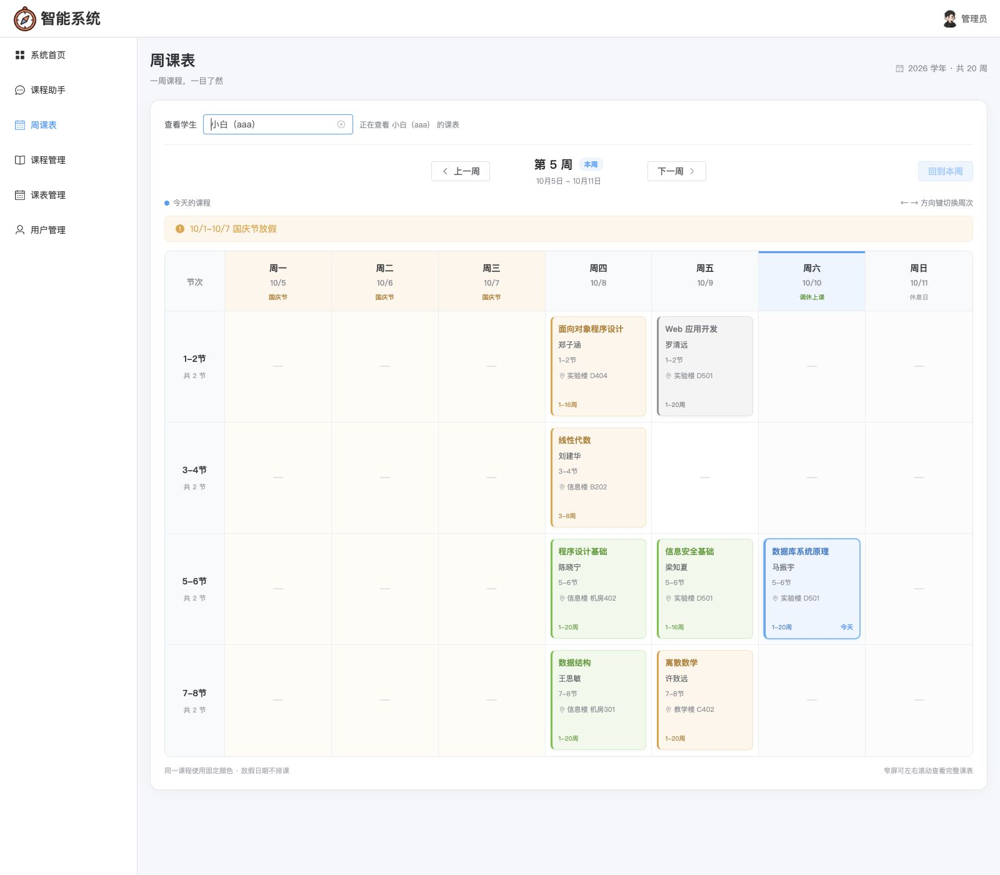
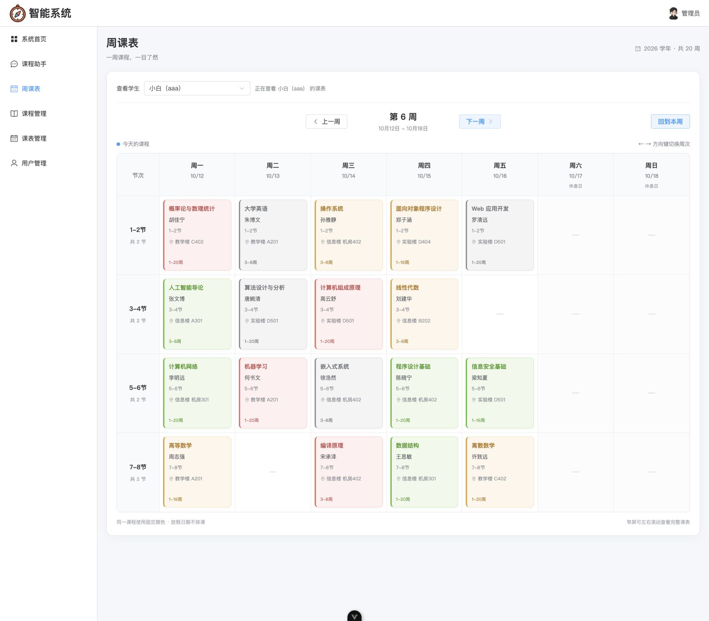
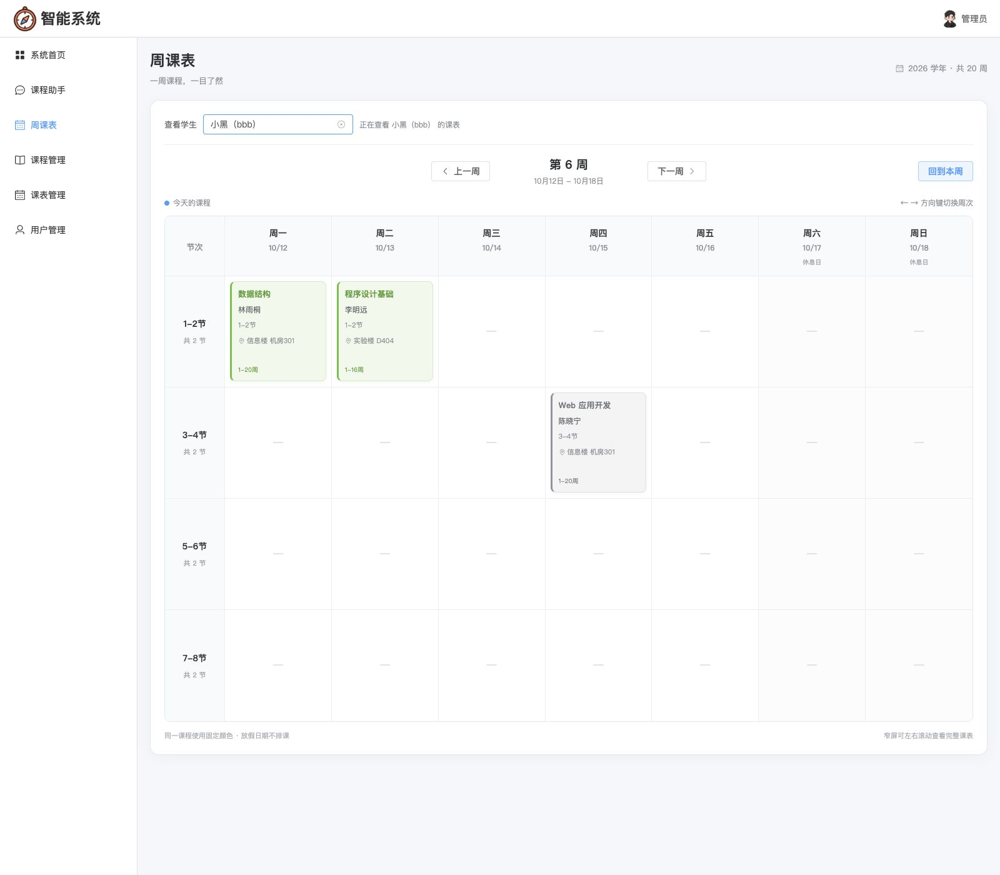

# P10 演示数据隔离与截图验收

本次只调整演示排课及验收证据，不修改后端用户过滤、`.env`、课表表结构、RAG 阈值或四份课程资料。管理员查看指定学生和学生忽略 `user_id` 的行为沿用 P9。

## 已复现的缺陷

修复前：`users 3 / coruses 22 / schedules 508 / documents 4 / study_plans 0`。aaa、bbb 各 254 条；忽略记录 ID 和所属学生后，`(class_date, period, course_id)` 交集为 254，独有各 0。20 周的有课格完全相同，第 6 周 16/16 格一致。这是演示内容重复，并非越权；原过滤逻辑无需修改。

## 新排课与安全范围

`build_schedule()` 在每个学生循环中独立调用课程分配，随机种子由固定根种子与该学生 ID 派生。aaa 密集排课，bbb 只选 5 门唯一课程，通常每周 2~3 个工作日有课，两人仍均覆盖全部 20 周。周六和周日课程只在 2026-10-10、2026-09-20 两个调休日展开；不是复制其他星期的课程。

P9 合并后的数据结构课程保留 ID=2。历史 DS101/CS201 模板别名在排课时按 `course_id` 折叠，不再为同一学生同一课程安排两个固定格；课程库仍为 22 门无重名课程。每人的每门课在整个学期保持同一个实际星期/节次，周次范围真实过滤，假期和普通周末不排课。

`--clean` 只删除启用的演示学生 aaa/bbb、模板课程 ID、2026-09-07 至 2027-01-24 这个学期范围三条件同时命中的课表。它不删除课程、文档、学习计划、其他学生记录、非模板课表或其他学期课表。默认同步亦限定相同范围。删除前落盘完整课表备份供人工恢复；清理及重建在事务中完成，异常回滚。

```bash
# 只读预览，不改数据库
.venv/bin/python tests/manual/seed_demo_schedules.py --preview

# 已确认安全范围后重造演示课表；保留 22 门课程
.venv/bin/python tests/manual/seed_demo_schedules.py --reseed --no-courses

# 再跑一次必须是零新增、零更新、零删除
.venv/bin/python tests/manual/seed_demo_schedules.py --no-courses
```

本次修改前备份为 `backups/demo_schedules/20261010T124507Z-a4dbfc95.json`，包含原 508 条演示课表及清理范围，位于 Git 忽略目录中。恢复时根据备份完整字段在数据库事务内核对并恢复，不能先删课程再恢复外键。

本次真实重造输出：

```text
唯一课程：22 门（新建 0 门）；课表新增 314，更新 0，移除旧演示记录 508，未变化 0
数据版本：P10-student-isolation-v1
aaa（小白）：259 条课表
bbb（小黑）：55 条课表
```

重复同步输出 `新增 0，更新 0，移除旧演示记录 0，未变化 314`，并核对全部课表 ID 与时间戳一致。禁止通过删除课程、重传 RAG 文档或扩大清理范围来重造课表。

## 差异统计口径

以每周 `(class_date, period)` 为格子，比较两人有课格的并集。双方在同格且 `course_id` 相同才算“相同”；仅一方有课或双方课程不同都算“不同”。双方都空的格子不进入分母，避免周末与假期空格掩盖数据重复。差异率 = 不同格数 / 有课格并集数，要求每周 ≥80%。它与 SQL 课表记录 ID 的不相交是两种检查：前者证明演示内容不同，后者连同 JWT/user_id 注入检查证明身份隔离仍正确。

种子脚本按计划生成摘要；真实冒烟从 HTTP 响应独立计算同一口径，不导入种子代码、应用配置或 `.env`。它也逐周与各自 `GET /api/schedules` 列表核对，管理员查 aaa 的 20 周必须与 aaa 本人视图完全一致。

```bash
.venv/bin/python tests/manual/week_schedule_smoke.py
```

脚本只依赖已运行的 FastAPI 8000，不启动 MCP、不读 Key、不改数据。通过真实登录获取 aaa/bbb/admin JWT，JWT 不输出。每周动态统计，不再要求两人各 254 条或旧调休日固定门数；断言每人每周有课、两次调休均有课、假期及普通周末无课、bbb 每周最多 3 个工作日且仅 3~5 门课、每人同课程固定格、20 周差异 ≥80%、管理员视图及学生防越权。打印逐周摘要、aaa 第 3/5/6 周网格及第 6 周双学生并排网格，失败退出码非 0。

## 当前数据与逐周实测

数据版本：**P10-student-isolation-v1**，固定根种子 `20261010`。真实数据库核对：`users 3 / coruses 22（无重名）/ schedules 314 / documents 4 / study_plans 0`；aaa 259 条，bbb 55 条。用户、全部 22 门课程完整行、4 份文档记录与原文件、学习计划、`.env`、课表表结构及后端原过滤逻辑通过修改前后摘要核对。

真实种子输出与独立 HTTP 冒烟逐项一致的逐周差异如下；总占用格并集 285 格，相同 0 格，每周差异均为 100%。当双方同格但课程不同，它只计一个差异格，因此“不同”不必等于 aaa 与 bbb 课节数相加。

| 周次 | aaa 课节数 | bbb 课节数 | 相同格 | 不同格 | 差异率 |
| --- | --- | --- | --- | --- | --- |
| 1 | 12 | 3 | 0 | 14 | 100% |
| 2 | 13 | 4 | 0 | 16 | 100% |
| 3 | 15 | 3 | 0 | 15 | 100% |
| 4 | 11 | 2 | 0 | 11 | 100% |
| 5 | 8 | 2 | 0 | 9 | 100% |
| 6 | 18 | 3 | 0 | 18 | 100% |
| 7 | 18 | 3 | 0 | 18 | 100% |
| 8 | 18 | 3 | 0 | 18 | 100% |
| 9 | 14 | 3 | 0 | 16 | 100% |
| 10 | 14 | 3 | 0 | 16 | 100% |
| 11 | 14 | 3 | 0 | 16 | 100% |
| 12 | 14 | 3 | 0 | 16 | 100% |
| 13 | 14 | 3 | 0 | 16 | 100% |
| 14 | 14 | 3 | 0 | 16 | 100% |
| 15 | 14 | 3 | 0 | 16 | 100% |
| 16 | 14 | 3 | 0 | 16 | 100% |
| 17 | 7 | 2 | 0 | 8 | 100% |
| 18 | 9 | 2 | 0 | 10 | 100% |
| 19 | 9 | 2 | 0 | 10 | 100% |
| 20 | 9 | 2 | 0 | 10 | 100% |

第 6 周（2026-10-12 至 10-18）从重造后冻结的真实课表读取，并经真实 HTTP 接口逐格核对，并排网格如下。普通周末四档均为空；该周 aaa 18 节，bbb 3 节，虽然三个 bbb 格子也被 aaa 占用，但三格的课程均不同。

| 日期 | 节次 | aaa | bbb |
| --- | --- | --- | --- |
| 周一 10/12 | 1-2节 | 概率论与数理统计 [ID=67] | 数据结构 [ID=2] |
| 周一 10/12 | 3-4节 | 人工智能导论 [ID=59] | — |
| 周一 10/12 | 5-6节 | 计算机网络 [ID=54] | — |
| 周一 10/12 | 7-8节 | 高等数学 [ID=3] | — |
| 周二 10/13 | 1-2节 | 大学英语 [ID=1] | 程序设计基础 [ID=48] |
| 周二 10/13 | 3-4节 | 算法设计与分析 [ID=51] | — |
| 周二 10/13 | 5-6节 | 机器学习 [ID=60] | — |
| 周二 10/13 | 7-8节 | — | — |
| 周三 10/14 | 1-2节 | 操作系统 [ID=53] | — |
| 周三 10/14 | 3-4节 | 计算机组成原理 [ID=52] | — |
| 周三 10/14 | 5-6节 | 嵌入式系统 [ID=64] | — |
| 周三 10/14 | 7-8节 | 编译原理 [ID=57] | — |
| 周四 10/15 | 1-2节 | 面向对象程序设计 [ID=49] | — |
| 周四 10/15 | 3-4节 | 线性代数 [ID=66] | Web 应用开发 [ID=61] |
| 周四 10/15 | 5-6节 | 程序设计基础 [ID=48] | — |
| 周四 10/15 | 7-8节 | 数据结构 [ID=2] | — |
| 周五 10/16 | 1-2节 | Web 应用开发 [ID=61] | — |
| 周五 10/16 | 3-4节 | — | — |
| 周五 10/16 | 5-6节 | 信息安全基础 [ID=62] | — |
| 周五 10/16 | 7-8节 | 离散数学 [ID=58] | — |
| 周六 10/17 | 1-2节 | — | — |
| 周六 10/17 | 3-4节 | — | — |
| 周六 10/17 | 5-6节 | — | — |
| 周六 10/17 | 7-8节 | — | — |
| 周日 10/18 | 1-2节 | — | — |
| 周日 10/18 | 3-4节 | — | — |
| 周日 10/18 | 5-6节 | — | — |
| 周日 10/18 | 7-8节 | — | — |

真实 HTTP 冒烟回查 aaa 259 条、bbb 55 条，与各自现有列表的记录集合完全一致；管理员查 aaa 的 20 周响应与 aaa 本人视图完全一致。学生逐周注入另一名学生的 `user_id` 仍只返回本人身份及本人记录；管理员默认查自己，不存在学生返回业务 404。周次 0/21/abc/1.5 返回业务 400，无 Token/伪造 Token 返回 HTTP 401 及业务码 401。

两个调休日（9/20 周日、10/10 周六）两人各自均有 1 门专属课，全部假期及其他周末为空。aaa 第 5 周真实网格为：周四四档依次“面向对象程序设计、线性代数、程序设计基础、数据结构”；周五 1-2/5-6/7-8 节依次“Web 应用开发、信息安全基础、离散数学”；周六 5-6 节为“数据库系统原理”。周一至周三国庆为空，周日普通周末为空，共 8 节。这也是重新截图所对应的数据。

## 截图与数据库对应记录

截图必须使用重造后的真实浏览器界面。课程卡片以 `course_id` 保持跨周同色；由于每门课仅一个固定格，不再用同周两张数据结构卡片作为证据。原 `P8-week5.jpg` 与 `P9-admin-aaa-week6.jpg` 覆盖后，P8/P9 文档已明确旧静态网格属于历史版本，并指向本页当前记录。

| 文件 | 截图时间（Asia/Shanghai） | 登录/查看账号 | 周次 | 数据版本与核对 |
| --- | --- | --- | --- | --- |
| [P8-week5.jpg](screenshots/P8-week5.jpg) | 2026-10-10 20:52:16 +08:00 | admin / aaa | 5 | P10-student-isolation-v1；28 格核对、8 节，前三天国庆空、周六调休有课 |
| [P9-admin-aaa-week6.jpg](screenshots/P9-admin-aaa-week6.jpg) | 2026-10-10 20:52:42 +08:00 | admin / aaa | 6 | P10-student-isolation-v1；28 格核对、18 节，选择器与正在查看提示可见 |
| [P10-admin-bbb-week6.jpg](screenshots/P10-admin-bbb-week6.jpg) | 2026-10-10 20:54:12 +08:00 | admin / bbb | 6 | P10-student-isolation-v1；28 格核对、3 节，直接展示与 aaa 的区别 |

上述时间来自截图保存记录。截图数据状态均为课程 22、课表 314（aaa 259/bbb 55）、文档 4、学习计划 0。2026-10-10 20:50:00 +08:00 已将接口与数据库精确比对；截图时再逐格核对真实 DOM 中的名称、节次、教师、地点、周次范围与接口，三图各 28 格均一致。截图记录、完整网格及颜色证据保存于 [P10-screenshot-manifest.json](screenshots/P10-screenshot-manifest.json)。







真实浏览器核对同课程跨周配色：数据结构 `course_id=2` 在 aaa 第 5/6 周均为周四 7-8节，四个 CSS 色值变量完全一致，均使用 Element Plus success 绿色；bbb 第 6 周的同 ID 卡片也为同色，但它位于周一 1-2节。因此这些截图既证明同课程跨周配色稳定，也直接显示两名学生的课程位置不同。独立原图审查确认第 6 周 aaa 周五 7-8节为离散数学，与当前数据库及 DOM 一致。

## 回归结果

后端 **364 项**、前端 **43 项**离线测试全部通过，生产构建成功。后端原 345 项加 19 项新测试；新增种子测试覆盖不同学生、每周差异上限、20 周覆盖、节假日、调休、固定课程格、安全清理与幂等；新增只读摘要测试独立覆盖相同格定义、空格不计分母、80% 边界、20 周顺序及动态文本输出。

8 个既有冒烟及周课表真实冒烟全部退出码 0，依次执行并在每项结束后核对冻结的新课表与受保护资产未变化。8001 临时释放供脚本管理 MCP，全部结束后恢复原项目 MCP 服务。

| 脚本 | 实测耗时 | 退出码 |
| --- | --- | --- |
| `e2e_mcp` | 6.1 秒 | 0 |
| `agent_smoke` | 8.3 秒 | 0 |
| `p3_smoke` | 24.5 秒 | 0 |
| `sse_contract` | 0.3 秒 | 0 |
| `sse_smoke` | 16.0 秒 | 0 |
| `rag_smoke` | 34.5 秒 | 0 |
| `p5_business_smoke` | 6.0 秒 | 0 |
| `p7_quality_smoke` | 18.1 秒 | 0 |
| `week_schedule_smoke` | 2.0 秒 | 0 |
