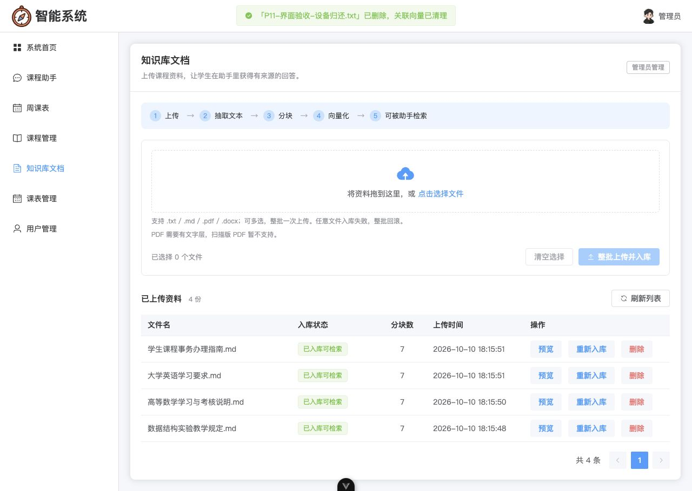

# P11：管理员知识库文档管理

验收日期：2026-10-10（Asia/Shanghai）。页面路由 `/manager/document`，管理员侧栏「知识库文档」位于「课程管理」之后、「课表管理」之前。

## 页面行为

- 拖拽或多选 `.txt / .md / .pdf / .docx`，点击「整批上传并入库」。顶部展示上传 → 抽取文本 → 分块 → 向量化 → 可被助手检索的流程。
- 复用现有 `src/api/document.js`。一次调用 `uploadDocumentsApi`，一个 `FormData` 中多次追加同名 `files`，只有一次 POST；不设置 `Content-Type`，由 axios/浏览器补充 multipart 边界。
- 上传进度达到 100% 只表示文件发送完毕，页面继续显示正在抽取/分块/向量化，直到后端返回结果。业务失败保留后端具体文件名与原因；不把 HTTP 200 误当成业务成功。
- 选择器与整批校验均限制四种格式。拖入 PNG 时保留整个选择列表、展示错误、禁用整批上传，不会偷偷上传合法文件子集。扫描版 PDF 的文本抽取错误由后端明确返回，页面显示原消息。
- 分页列表展示文件名、状态、分块数、上传时间及操作。`indexed` 为绿色「已入库可检索」，`processing` 为蓝色「重建中」，`failed` 为红色「失败」，错误详情可悬停查看。
- 预览使用纯文本插值与可滚动 `pre`，`white-space: pre-wrap`；不将文档内容作为 HTML 执行。
- 重新入库、删除均二次确认。确认框出现前同步锁住该行，快速连点只会产生一次动作。后端状态为 `processing` 时重新入库按钮禁用。删除提示明确说明同步清理该文档全部向量。
- 删除最后一页的最后一项时自动回到有效页；加载、空列表与请求失败都有对应 UI。空列表提示「先上传课程资料，学生才能在助手里提问」。
- 菜单只对管理员显示；路由角色守卫把学生重定向 `/manager/home`，组件自身也检查角色、不发文档请求。后端原有五接口管理员鉴权继续生效。

现有 API 封装只补充了重新入库的 `timeout: 120000`，与其已有上传超时保持一致，避免向量化尚未完成时被通用 30 秒超时打断。没有重写封装或新增依赖；`Home.vue`、后端源码/测试、`.env` 均保持原样。

## 真实操作记录

完整接口返回：[P11-interface-records.json](./P11-interface-records.json)。脚本运行时间 22:26:46–22:27:28，退出码 0。所有上传内容都是本轮虚构测试资料；测试完成后均已删除。

| 操作 | 时间（+08:00） | 实际请求与结果 |
| --- | --- | --- |
| 批量上传 | 22:26:53 | 一个 `POST /api/documents/upload`、两个同名 `files` 字段；HTTP 200、业务 200；新文档 56/57 均 `indexed`、各 2 块 |
| 预览 | 22:26:53 | `GET /api/documents/56/preview`，业务 200，抽取文本与上传正文逐字一致；57 同样通过 |
| 重新入库 | 22:26:56 | `POST /api/documents/56/reindex`，业务 200、仍 2 块；总向量 32 → 32，没有重复向量 |
| 删除 | 22:27:06 | `DELETE /api/documents/56`，业务 200；向量 32 → 30，该文档向量归零、检索不再返回其 ID/来源 |
| 清理第二份测试资料 | 22:27:14 | `DELETE /api/documents/57`，业务 200；向量 30 → 28，原文/记录/向量恢复基线 |

另外完成真实界面预览、重新入库和删除：[P11-ui-operation-records.json](./P11-ui-operation-records.json)。该组上传通过一次真实 HTTP 请求创建文档 54（2 块）和 55（1 块）；页面加载后操作它们，重新入库向量保持 31，删除后向量依次 31 → 29 → 28。下方截图记录此组界面状态，不与脚本的 56/57 混用。

### 故意混入 PNG：两层验证

界面实测混选 `P11-回滚验收-正常.md` 与 `P11-回滚验收-不支持.png`，显示：

> 整批未上传：P11-回滚验收-不支持.png：仅支持 .txt、.md、.pdf、.docx 文件。请移除不支持的文件后重试。

上传按钮禁用，没有发出上传请求，资料仍为 4 份。这个前置拦截不等于已经验证后端回滚，因此脚本另行通过 HTTP 提交「正常 md 在前、PNG 在后」的完整批次，22:27:00 返回：

```json
{
  "code": 400,
  "message": "文件「P11DOC-6b8bee4f7075491083aa37531db3526e-不支持图片.png」入库失败：仅支持 .txt / .md / .pdf / .docx 文档；整批已回滚",
  "data": null
}
```

回滚前后文档 ID 集合均为 `[17,18,19,20,56,57]`，文档数 6 → 6，原文文件集合与文件哈希不变，向量 32 → 32。正常 md 也没有遗留记录、原文或向量。最后删除 56/57 后恢复 4 份演示资料、28 个向量。

### 学生访问

学生 aaa 登录后，没有「知识库文档」菜单；直接访问 `/manager/document` 实测最终 URL 为 `/manager/home`，文档区域不存在。另用其 JWT 调用列表、上传、预览、重新入库、删除五接口，全部业务码 403、消息「无权限访问」。后四项使用测试文件/不存在的测试 ID，不操作演示文档。返回记录：[P11-permission-records.json](./P11-permission-records.json)。

## 截图与对应数据

截图时间均为 2026-10-10、+08:00，数据版本为 P11 临时验收批次；全部来自真实界面。文件时间/说明另存于 [P11-screenshots.json](./screenshots/P11-screenshots.json)。

| 文件 | 时间 | 账号与数据状态 |
| --- | --- | --- |
| [P11-documents-upload.jpg](./screenshots/P11-documents-upload.jpg) | 22:13:55 | admin；54/55 上传后，共 6 份，原有四份各 7 块 |
| [P11-document-preview.jpg](./screenshots/P11-document-preview.jpg) | 22:14:25 | admin；预览 54 的真实抽取文本，2 块、92 字符 |
| [P11-document-reindex.jpg](./screenshots/P11-document-reindex.jpg) | 22:19:22 | admin；54 重新入库确认，行按钮已禁用 |
| [P11-document-delete-confirm.jpg](./screenshots/P11-document-delete-confirm.jpg) | 22:20:18 | admin；54 删除确认，明确清理全部向量 |
| [P11-document-delete.jpg](./screenshots/P11-document-delete.jpg) | 22:21:14 | admin；54/55 均删除，恢复四份演示资料 |
| [P11-document-bad-batch.jpg](./screenshots/P11-document-bad-batch.jpg) | 22:26:22 | admin；混选正常 md 与 PNG，整批禁用并指出错误文件 |
| [P11-student-permission.jpg](./screenshots/P11-student-permission.jpg) | 22:27:48 | aaa；直接访问文档路由被拦截，首页无该菜单/内容 |



## 可重复验收与回归

从 `scaffold/frontend` 执行：

```bash
node --test tests/*.test.mjs
npm run build
../backend/.venv/bin/python tests/manual/document_management_smoke.py
```

冒烟复用已启动的 FastAPI（8000），不启动或停止 MCP。它会使用 backend 已配置的 SiliconFlow embedding，对虚构测试资料进行真实入库与检索；不要与其他管理员文档写操作同时执行。每次使用独立文件名标记，写操作全部走上述 HTTP 业务接口；数据库读取只用于资产/回滚核对。成功或失败都在 `finally` 清理本轮测试文档，失败退出码非 0。默认覆盖 `docs/P11-interface-records.json`；可用 `--output` 保留多次结果。

本次回归：

- 前端原 43 项 + 新增 24 项 = **67/67 通过**；覆盖四种文件类型/混批、状态映射、实际 FormData 多文件单请求且无手动 Content-Type、进度、具体业务错误、确认前同步锁、processing 禁用、删除确认/取消、长文本转义、管理员/学生菜单路由与组件访问。
- 后端 **364/364 通过**，没有改后端逻辑或测试。
- 生产构建通过；仅有项目既有打包大于 500 kB 的提示。
- 文档管理真实冒烟 **EXIT=0**，上传/预览/重新入库/坏批次回滚/删除清向量及检索均通过。

最终完整资产核对：`users=3 / coruses=22 / schedules=314（aaa=259、bbb=55）/ documents=4 / study_plans=0`。演示文档 ID 17/18/19/20 均 `indexed`、各 7 块，总向量 28；其记录、原文、向量数量未变。其他业务表完整行哈希、后端源码/测试、`.env`、`Home.vue` 和依赖文件均与本轮开始时一致。
